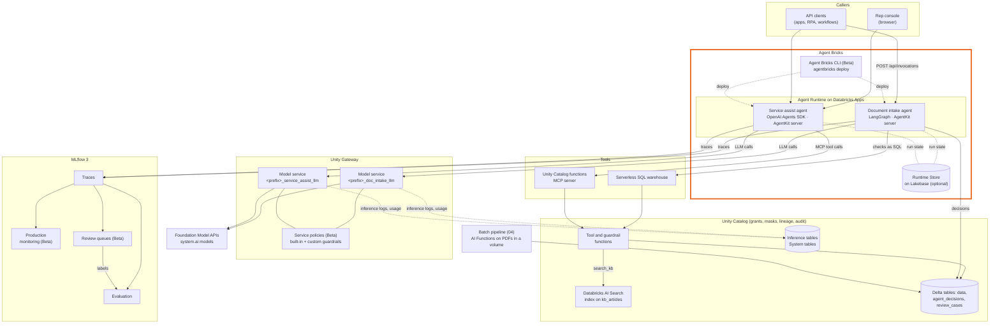
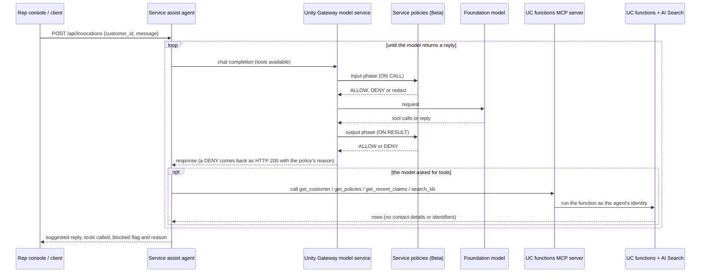

# Architecture

How the parts of the starter fit together, which parts are Databricks features used as they are, and which parts
are code in this repository. Release status of each feature is in [feature-status.md](feature-status.md); features
in Beta are marked **(Beta)** here.

## Components

The agents are deployed as the apps `agent-bricks-<prefix>-intake` and `agent-bricks-<prefix>-assist`. Each
has its own service principal, MLflow experiment and model service.

The bundle is not drawn: a Declarative Automation Bundle (`databricks.yml`, `resources/jobs.yml`) deploys the
notebooks and four jobs from Git, and the `agentic-starter-deploy` job runs the notebooks in order on serverless,
including `90_deploy_agents`, which runs `agentbricks deploy` for both agents.

Governance applies across the diagram: Unity Catalog grants on every schema, table, function and model service,
a column mask on `customers.national_id`, a service principal per agent with least-privilege grants (`91`), and
audit, lineage, usage and billing in system tables (`10`).

## Agent Bricks

[Agent Bricks](https://learn.microsoft.com/en-us/azure/databricks/agents/concepts/) is the Databricks agent
developer platform for agents written in code. You bring the agent loop, built with any framework, and choose the
model; Agent Bricks provides the managed parts a production agent needs around it. The documentation groups its
components by what they solve:

| Area | Agent Bricks components (per the documentation) | In this starter |
|---|---|---|
| Compute | **Agent Runtime** (agents hosted on Databricks Apps with an authenticated endpoint, a service principal per agent, tracing, 1–5 instances); **AgentKit** and its agent server `DurableAgentServer` (invocation API, background runs, idempotent invocations, crash recovery); **Databricks Sandbox** (Beta, isolated code execution) | Both agents run on Agent Runtime. With `enable_lakebase = True` they use `DurableAgentServer`; with `False`, a FastAPI server (`server = "custom"`). Sandbox is not used |
| Build and deploy | **Agent Bricks CLI** (Beta): scaffolds, runs locally (`agentbricks dev`) and deploys (`agentbricks deploy`) from a declarative `agent.toml` | `90_deploy_agents` runs `agentbricks deploy`; `92_teardown` runs `agentbricks deployments delete`. `agent.toml` binds each agent's model service and MLflow experiment |
| Run state | **Runtime Store**, a dedicated database in a Databricks-managed Lakebase project, provisioned by `agentbricks deploy` | Used when `enable_lakebase = True` |
| Context | **Agent memory and sessions** (managed stores backed by Lakebase); MCP servers and agent tools; Databricks AI Search; Genie Agents | Tools are Unity Catalog functions (through the UC functions MCP server and SQL) and an AI Search index. Both agents are single-turn (each request stands alone), so memory, sessions and Genie Agents are not used |
| Model access | Unity Gateway and Foundation Model APIs | One Unity Gateway model service per agent, routed to a `system.ai` model |
| Quality | MLflow tracing, evaluation and monitoring | `06`–`09` |
| Governance and control | Unity Catalog, and Unity Gateway policies | Grants, column mask, service policies, system tables (`02`, `05`, `10`, `91`) |

Agent Runtime, AgentKit, the Agent Bricks CLI, the Runtime Store, memory and sessions, and Sandbox are specific to
Agent Bricks. Unity Gateway, Unity Catalog, MLflow, AI Search and Genie Agents are Databricks products in their own
right that Agent Bricks uses, so the diagram draws them as separate boxes. They share one identity and governance
model: each agent runs as its app's service principal, and Unity Catalog checks that identity on every model,
function and table, so the grants in `91` decide what each agent can reach.

Two Agent Bricks capabilities are natural next steps for these agents:

- **Request-user authorization**: tools can run with the permissions of the user who sent the request
  (`auth = "user"` in `agent.toml`) instead of the agent's service principal. Requires `DurableAgentServer`.
- **Agent memory and sessions**: a multi-turn version of the service assist agent could keep each conversation in a
  session store and recall customer preferences from a memory store.

Low-code agents are a separate product, [Genie Agents](https://learn.microsoft.com/en-us/azure/databricks/genie-agents/),
which a code agent can call as a tool. The earlier agent builders, Knowledge Assistant and Supervisor Agent,
are listed in the documentation as [legacy offerings](https://learn.microsoft.com/en-us/azure/databricks/agents/legacy/).

## Request flows

### Document intake (fixed flow, routing in code)

1. A client sends `POST /api/invocations` with `{"document_id": ...}` or `{"text": ...}`.
2. `load` reads the parsed text from `doc_parsed` (written by `04`) through the SQL warehouse, or takes the text
   from the request.
3. `classify` and `extract` call the LLM through `<prefix>_doc_intake_llm`. The jailbreak and unsafe-content
   policies run on each call. Extraction returns each field with the exact text it was taken from.
4. `validate` checks required fields, checks that each quoted piece of evidence appears verbatim in the document,
   and calls the Unity Catalog functions `check_claim_policy` and `is_valid_iban` as SQL.
5. `decide` computes confidence in code (classification confidence × share of verified evidence) and applies the
   routing rule from `intake/doc_types.py`: `auto`, `auto_with_audit` (sampled) or `human_review`. Any failed check
   goes to `human_review`.
6. `record` writes `agent_decisions`, and `review_cases` when a person must look at it, both with the MLflow trace id.

The LLM never chooses the next step or the route.

### Service assist (tool-calling agent, person in the loop)

The rep reads the suggestion and decides what to send. The agent sends nothing to the customer.

## What Databricks provides and what this repository adds

| Component | Provided by Databricks | Added in this repository | Build type |
|---|---|---|---|
| Model access | Foundation Model APIs (pay-per-token) and the `system.ai` models | Choice of model per environment and a test call before deploying (`01`) | Existing product |
| LLM gateway | Unity Gateway model services: routing, fallback, rate limits, inference tables, usage system table | One service per agent, created from code (`05`) | Configurable |
| Guardrails | Service policies (Beta): built-in unsafe content, jailbreak, hallucination and sensitive-data detection; custom SQL-function and LLM-as-a-judge policies; Enforce and Log modes | Three custom SQL policy functions, one judge criterion, the attach plan and the guardrail test set (`05`, `assist/guardrails.py`) | Configurable + custom code |
| Tools | Unity Catalog functions (SQL and Python), the Unity Catalog functions MCP server, governance on functions | Six tool functions (`03`) | Configurable + custom code |
| Knowledge search | Databricks AI Search: managed embeddings, delta sync index, `vector_search()` in SQL | The index on `kb_articles` and the `search_kb` function (`03`) | Configurable |
| Document processing | AI Functions `ai_parse_document`, `ai_classify`, `ai_extract` with confidence scores | The SQL pipeline, document types and routing rule (`04`, `intake/doc_types.py`) | Configurable + custom code |
| Agent logic | Agent Bricks supports any framework; framework integrations `databricks-langchain` and `databricks-openai` | Both agents: the LangGraph flow and the OpenAI Agents SDK agent (`agents/doc_intake/intake/`, `agents/service_assist/assist/`) | Custom code |
| Agent server and hosting | Agent Bricks: Agent Runtime on Databricks Apps, AgentKit `DurableAgentServer`, Agent Bricks CLI (Beta). Provides the app, service principal, tracing binding and model service grant | `runtime/main.py` for each agent (durable or FastAPI mode), `agent.toml` and `app.yaml` templates | Existing product + custom code |
| Durable run state | Agent Bricks Runtime Store on Lakebase, provisioned by `agentbricks deploy` | `enable_lakebase` switch in `01` | Existing product |
| Rep console | Databricks Apps hosting and sign-in | A single HTML page served by the service assist app (`runtime/console.html`) | Custom code |
| Tracing and evaluation | MLflow 3 tracing, `mlflow.genai.evaluate`, evaluation datasets in Unity Catalog, built-in judges, code scorers | Datasets from the synthetic ground truth, scorers and judge guidelines (`08`) | Configurable + custom code |
| Monitoring and human review | MLflow production monitoring (Beta), MLflow review queues (Beta) | Scorer registration, queue setup, labels back into the datasets (`09`); the `review_cases` work queue | Configurable |
| Governance | Unity Catalog grants, column masks, lineage, audit and billing system tables | Grants per agent service principal (`91`), the column mask (`02`), governance queries (`10`) | Existing product + configurable |
| Delivery | Declarative Automation Bundles, deploy from the workspace Git folder or the CLI, serverless jobs | `databricks.yml`, four jobs, `90_deploy_agents`, `92_teardown` | Configurable |
| Data | | Synthetic customers, policies, claims, articles, 40 PDFs, service cases (`02`) | Custom code (replace with real sources) |

Build types: **Existing product** is used as Databricks provides it; **Configurable** is a Databricks feature set up
by this repository through its API or UI; **Custom code** is code in this repository that you own and change.

### What a production system adds on top

The starter stops at the agents' API. A production version of either agent also needs, built or configured by you:

- Real inputs: document arrival (email, upload, RPA) into the volume or the agent API, and real customer and policy
  data in place of the synthetic tables.
- A review application on `review_cases` (for example a Databricks App) and the downstream process that acts on
  `auto` routes.
- Caller identity: the agents run as their app service principals. `DurableAgentServer` supports tools that run
  with the requesting user's permissions (`auth = "user"`) if that is required.
- Promotion between workspaces with CI/CD: the bundle's `demo-legacy` target is a production-mode example; deploying
  from the workspace UI only targets the current workspace.
- Network and security settings of your workspace (private connectivity, IP access lists), and budgets on the model
  services.

## Design choices

**The document intake agent decides routes in code.** The LLM classifies and extracts; it does not choose the next
step or the route. Confidence is computed from the classification confidence and from whether each required
value's quoted evidence is found verbatim in the document, not from the model's own estimate. Failed checks always
route to human review. Every decision can be explained from the trace and the decision table.

**The service assist agent chooses its tools, inside guardrails.** It is a drafting aid for a person, so a
tool-calling loop is acceptable. Its limits are enforced outside the agent: the tools return no identifiers, the
data has column masks, and every model call passes the service policies.

**Guardrails decide what one message can decide.** A gateway policy sees a single request or reply. Rules that a
message can be judged on by itself (jailbreaks, unsafe content, sensitive data, restricted topics, promises, links)
are enforced there. Whether a reply is grounded in the agent's tool results needs the whole trace, so MLflow judges
check it in evaluation and monitoring, and the gateway's context-dependent judges run in Log mode.

**One model service per agent.** Each agent gets its own guardrails, rate limits, inference log and usage line in
`system.ai_gateway.usage`. Sensitive-data redaction is on for service assist and off for document intake, which
must read IBANs; that data is protected with grants instead.

**Same code in notebooks and in production.** The notebooks import the agent packages from `agents/`, so what is
evaluated in `08` is what is deployed.

**Tools stay Unity Catalog functions.** The service assist agent reaches them through the Unity Catalog functions
MCP server, and the document intake agent calls them as SQL. The Databricks documentation lists the MCP server as a
legacy workspace endpoint and points new Python agents to `UCFunctionToolkit` or a `uc_function` tool in
`agent.toml`. Both call the same functions with the same grants, so switching changes the agent's tool wiring, not
the tools.

**Two runtime modes, one agent code base.** Both modes run on Agent Runtime. With `enable_lakebase = True` the
agents run on `DurableAgentServer`, with background runs, event replay, idempotent invocation ids and recovery
after restarts, backed by a Runtime Store in Lakebase. With `False` they run as a FastAPI app with the same request
and response, for regions where Lakebase is not available.
